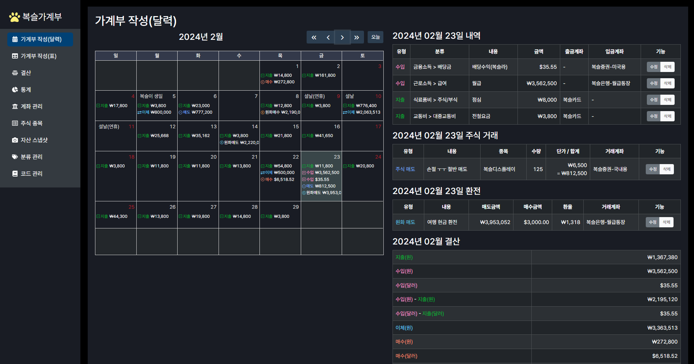
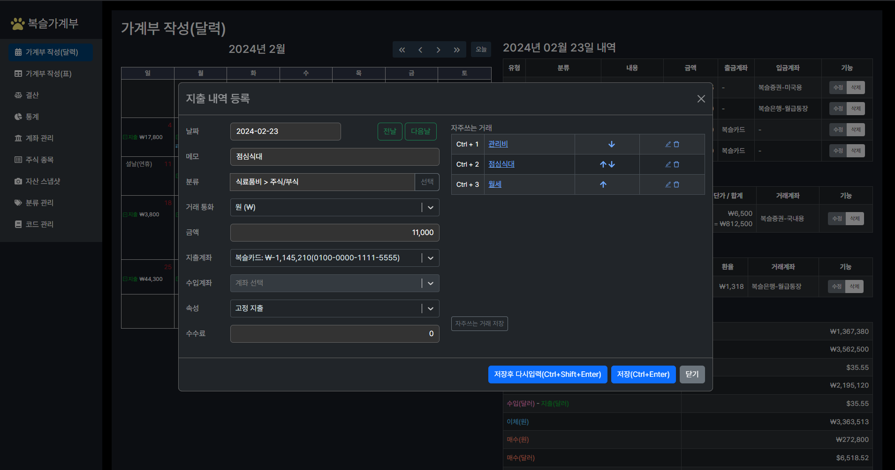
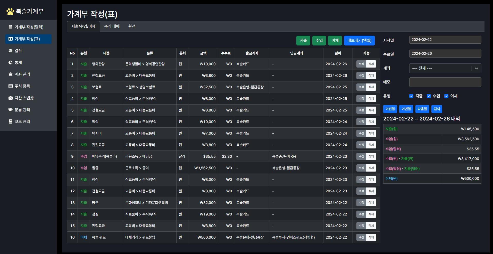
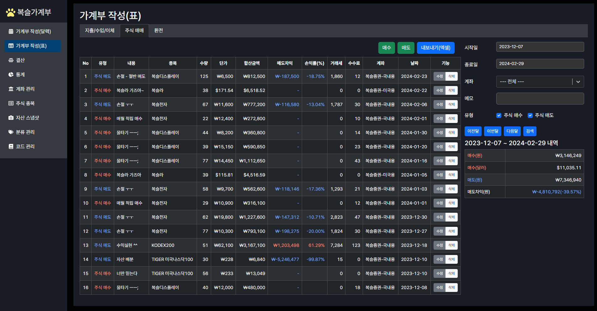
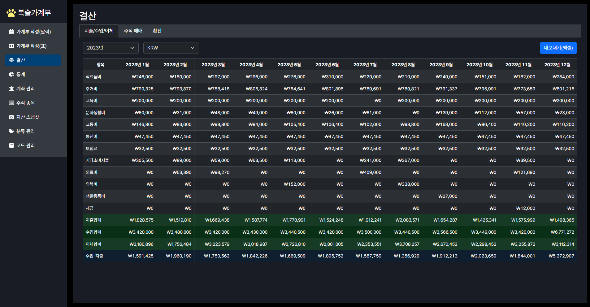
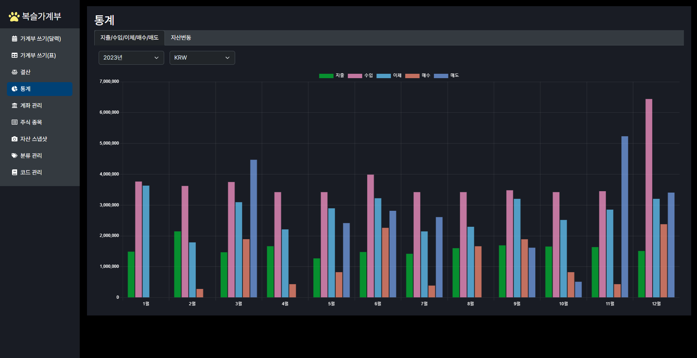
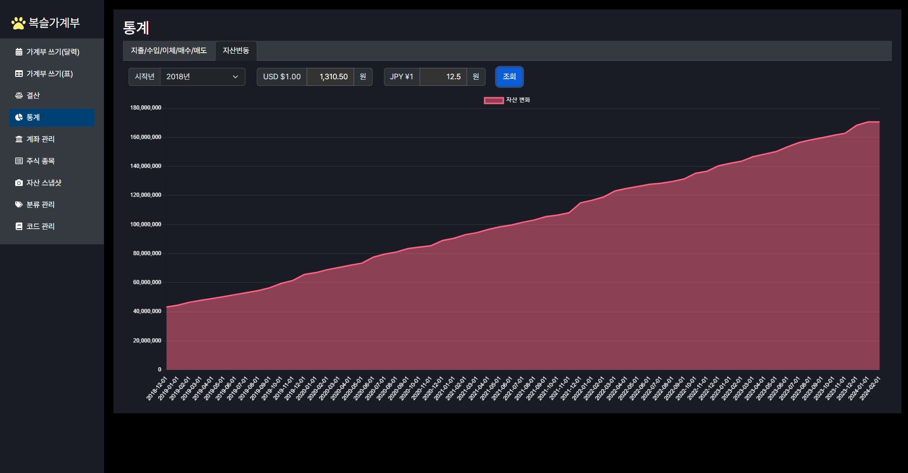
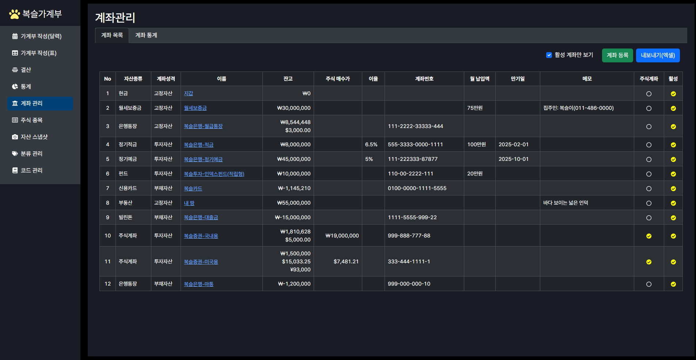
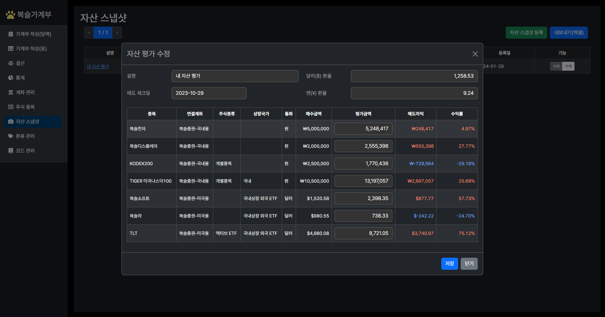
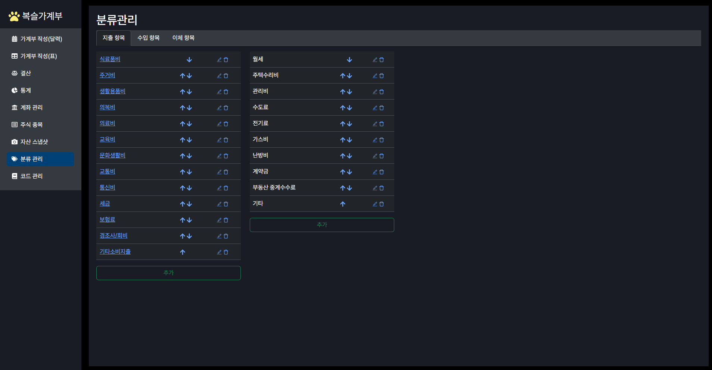

# 복슬가계부

[복슬머니](https://github.com/setvect/BokslMoneyApp) 후속작.<br/> 전작과 주요 차이점은 **외국통화**, **해외주식** 개념이 적용된 가계부 작성 기능 제공. 그리고 **다크 테마 UI** 적용.

## 1. 주요기능

- 계좌(통장, 카드, 주식 등) 등록 및 관리
- 다중 통화 관리
  - 환전
  - 환율이 적용된 자산 관리
- 주식 매매
  - 국내 주식 매매
  - 외국 주식 매매
- 달력 및 목록 방식 조회
- 자주쓰는 거래 내역 등록(단축키 입력)
- 년단위 기준 월 결산
- 결과 목록 엑셀 내보내기
- 분류 및 각종 코드관리
- 수입/지출/이체 내역 및 자산 변동 통계
  - 환율이 적용된 자산 가치 산출

## 2. 실행 및 빌드

### 2.1. 초기셋팅

권장 개발 환경:

- Node.js 20 LTS
- Python 3.11 이상
- macOS는 `xcode-select --install`로 Command Line Tools 설치 권장

참고:

- 이 프로젝트는 `bcrypt`, `sqlite3` 같은 네이티브 모듈을 Electron ABI에 맞춰 다시 빌드한다.
- Python 3.12 이상에서는 `node-gyp` 10 이상이 필요하며, 루트 `package.json`의 `overrides`로 고정되어 있다.

```shell
$ npm install

$ cd release/app
$ npm install
```

### 2.2. 실행 방법

```shell
$ npm start
```

### 검증 명령

- `npm run typecheck`: 소스와 빌드 설정의 TypeScript 타입 검사
- `npm test -- --runInBand`: 임시 SQLite DB 기반 서비스 테스트와 jsdom 기반 화면 테스트
- 일반 테스트는 개발 DB에 접근하지 않으며 샘플 데이터를 생성하지 않는다. 서비스 테스트는 Electron 실행이나 사전 번들 빌드 없이 실행된다.

### DB 업그레이드

- 앱 시작 시 필요한 마이그레이션만 실행한다. 기존 DB는 같은 폴더의 `.before-migration-날짜-UUID.bak` 파일로 먼저 백업한다.
- 업그레이드 실패 시 앱 시작을 중단하고 백업 위치를 안내한다. 앱을 종료한 상태에서 복구한다.
- 엔티티 자동 동기화는 사용하지 않는다. 지원 스키마, 새 마이그레이션 작성 및 복구 절차는 [DB 마이그레이션](doc/DB-MIGRATIONS.md)을 참고한다.

### 2.3. 빌드 방법 (인스톨 파일 생성)

```shell
$ npm run package
```

- 빌드 결과는 `release/build` 폴더에 생성됨

## 3. 설계 문서

- [테이블 설계서](doc/TABLE-SCHEMA.md)
- [날짜·금액·환율 및 화면 상태 규칙](doc/DATA-CONVENTIONS.md)

## 4. 주요화면

- 달력 보기
  

- 지출 입력
  

- 목록 보기
  

- 주식 매매 내역
  

- 결산 내역
  

- 월별 수입/지출/이체/매수/매도 그래프
  

- 자산 변환 그래프
  

- 계좌 목록
  

- 자산 스냅샷
  

- 분류 관리
  

## 5. 개발환경

프로젝트 초기환경은 [electron-react-boilerplate](https://github.com/electron-react-boilerplate/electron-react-boilerplate)를 기반으로 만들었음.

### 5.1. 주요 프레임워크 및 라이브러리

상세 버전은 [package.json](package.json)를 확인

- [typescript](https://www.typescriptlang.org)
- [electron](https://www.electronjs.org)
- [react](https://ko.legacy.reactjs.org)
- [sqlite3](https://www.sqlite.org)
- [React Bootstrap](https://react-bootstrap.netlify.app)
- [FullCalendar](https://fullcalendar.io)
- [react-hook-form](https://react-hook-form.com/)
- [moment](https://momentjs.com/)
- [lodash](https://lodash.com/)
- [Pretendard 글꼴](https://github.com/orioncactus/pretendard)

## 6. 관련 정보

### 6.1. 문제 해결에 도움이 된 사이트

- 대부분의 문제는 [GPT4](https://chat.openai.com/)에게 질문하여 해결 했음

### 6.2. 릴리즈 및 TODO(알려진 버그 포함)

- [RELEASE.md](RELEASE.md) 참고
- [TODO.md](TODO.md) 참고

### 6.3. 꿀팁

#### 6.3.1. 샘플 데이터 만들기

지출, 수입, 이체, 주식 거래, 환전등 각종 초기 데이터를 만들고 테스트 할 수 있도록 할 수 있음. 방법은 두 가지.

1. 프로젝트 루트에서 `npm run sample-data` 실행 (기존 개발 DB를 백업한 뒤 샘플 데이터로 교체)
2. 개발 환경으로 실행 후 메뉴 항목 에서 '복슬가게부' → '샘플 데이터 만들기'선택

개발 실행 모드에서만 가능

#### 6.3.2. 개발 실행과 Electron 복구

`npm start`는 renderer 개발 서버와 main 빌드·실행 스크립트를 사용한다. main 실행은 `.erb/scripts/start-main-dev.js`에서 `ELECTRON_RUN_AS_NODE`를 제거한 환경으로 시작한다.

- Electron 실행 파일 `ENOENT`: `node node_modules/electron/install.js`로 Electron 바이너리를 다시 설치한다. 설치 스크립트를 건너뛴 환경인지도 확인한다.
- 네이티브 모듈의 아키텍처/ABI 오류: `npm run rebuild`로 `release/app` 의존성을 현재 플랫폼에 맞게 복구한다.
- `npm run package`는 macOS 한글 앱 폴더를 압축기와 같은 NFD 형식으로 맞추고, 다중 아키텍처 패키징 후 개발 환경의 네이티브 모듈을 복구한다. 결과물은 `release/build`에 생성된다.
- 로컬 미서명 검증은 macOS에서 `CSC_IDENTITY_AUTO_DISCOVERY=false npm run package`를 사용했다. 실제 배포 서명·공증은 별도 자격 증명이 필요하다.

#### 6.3.3. 프로그램 로그

인스톨 후 로그 파일 저장되는 경로

- 윈도우: `C:\Users\[사용자 이름]\AppData\Roaming\boksl-account-book\logs`
- 맥: `~/Library/Logs/boksl-account-book/logs`

#### 6.3.4. DB 파일 저장 경로

[AppDataSource.ts](src/main/config/AppDataSource.ts) `DB_PATH` 변수 참고

- 개발환경 실행 시: `db/BokslAccountBook.db` (상대경로)
- 윈도우: `C:\Users\[사용자 이름]\AppData\Roaming\boksl-account-book\BokslAccountBook.db`
- 맥: `~/Library/Application Support/boksl-account-book/BokslAccountBook.db`
